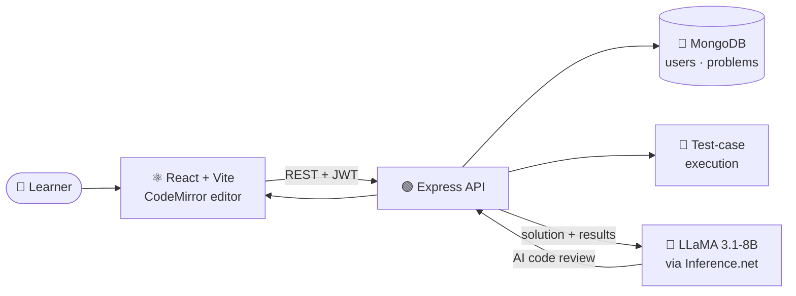
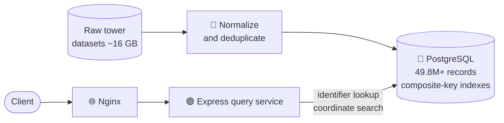

<!-- ===================== HEADER ===================== -->
<div align="center">


<a href="https://github.com/dhirj111">
  
</a>

<br/>

[](https://github.com/dhirj111)
[](https://modernleet.com)
[](https://celldataengine.com)


</div>

---

## 👨‍💻 About

I'm a **full-stack developer** who is happiest on the backend — designing REST APIs, modelling data, and making large datasets fast to query. I build and run products end to end: from the React interface to the database, and all the way to the Linux server and Nginx config that serves it.

```text
🔭 Focus        →  Backend engineering · system design · AI-powered products
⚙️  Day to day   →  Node.js / Express · TypeScript · React · MongoDB · PostgreSQL · MySQL
🤖 AI           →  LLM integration (LLaMA, Gemini, OpenAI) inside real product workflows
☁️  Ops          →  Oracle Cloud · Linux · Nginx · Docker
🚢 Shipping     →  Two live production sites (links below)
```

---

## 🚀 Live Projects

<table>
<tr>
<td width="50%" valign="top">

### 🧠 [ModernLeet](https://modernleet.com)
**AI-powered coding practice platform**

A LeetCode-style environment where you solve problems in an in-browser editor and get **AI-assisted code review** on your solution.

- CodeMirror-based interactive coding interface
- APIs for questions and test-case execution
- Code reviews from **LLaMA 3.1-8B** via Inference.net
- JWT auth, **email OTP verification**, password recovery
- Dedicated coding and challenge sections, fully responsive

`React` `Vite` `Node.js` `Express` `MongoDB` `JWT` `LLaMA`

[🌐 Visit site](https://modernleet.com)

</td>
<td width="50%" valign="top">

### 📡 [CellDataEngine](https://celldataengine.com)
**Global cell-tower intelligence platform**

A geospatial data platform for looking up cellular towers by network identifiers or by coordinates, built on a large, cleaned, deduplicated dataset.

- Normalized **~16 GB** of tower datasets from multiple sources
- Imported and deduplicated **49.8M+ records** in PostgreSQL
- Composite-key data organization with indexed lookups
- Query services for network identifiers and coordinate search
- Deployed on **Oracle Cloud** behind **Nginx**

`Node.js` `Express` `PostgreSQL` `SQL` `Oracle Cloud` `Nginx` `Linux`

[🌐 Visit site](https://celldataengine.com)

</td>
</tr>
</table>

### 🔎 How ModernLeet works



### 🗺️ How CellDataEngine works



---

## 🧩 More Work

| Project | What it demonstrates | Stack |
|---|---|---|
| [**WowCalorie**](https://github.com/dhirj111/wowcalorie) | Relational modelling of users and dishes, secure auth, image upload pipeline | Express · Sequelize · MySQL · JWT · bcrypt · Multer · Cloudinary |
| [**GroupChat**](https://github.com/dhirj111/groupchat) | Real-time messaging with room-based groups and membership models | Express · Socket.IO · Sequelize · MySQL · JWT |

> 📦 Browse all public repositories on [**github.com/dhirj111**](https://github.com/dhirj111?tab=repositories).

---

## 🛠️ Tech Stack

<div align="center">

| Layer | Technologies |
|:---|:---|
| **Languages** |      |
| **Frontend** |    |
| **Backend** |     |
| **Databases** |     |
| **AI / LLMs** |    |
| **DevOps & Tools** |        |

</div>

---

## 💡 What I Bring

- **Data at scale** — cleaning, deduplicating and indexing tens of millions of rows so lookups stay fast.
- **API craftsmanship** — clean REST design, JWT auth and authorization, OTP flows, and sensible error handling.
- **AI in production** — wiring LLMs into real user flows (code review), not just demos.
- **Real-time systems** — Socket.IO rooms, membership models and persistent message history.
- **Ownership of the full path** — schema → API → UI → server → domain → Nginx.

---

## 📊 GitHub Analytics

<div align="center">


</div>

---

## 🤝 Let's Connect

<div align="center">

I'm open to backend and full-stack opportunities, and to interesting collaborations.
The best way to reach me is through GitHub — open an issue or follow along.

[](https://github.com/dhirj111)
[](https://modernleet.com)
[](https://celldataengine.com)

<br/>

*Building, learning, and solving real-world problems through code.*


</div>
